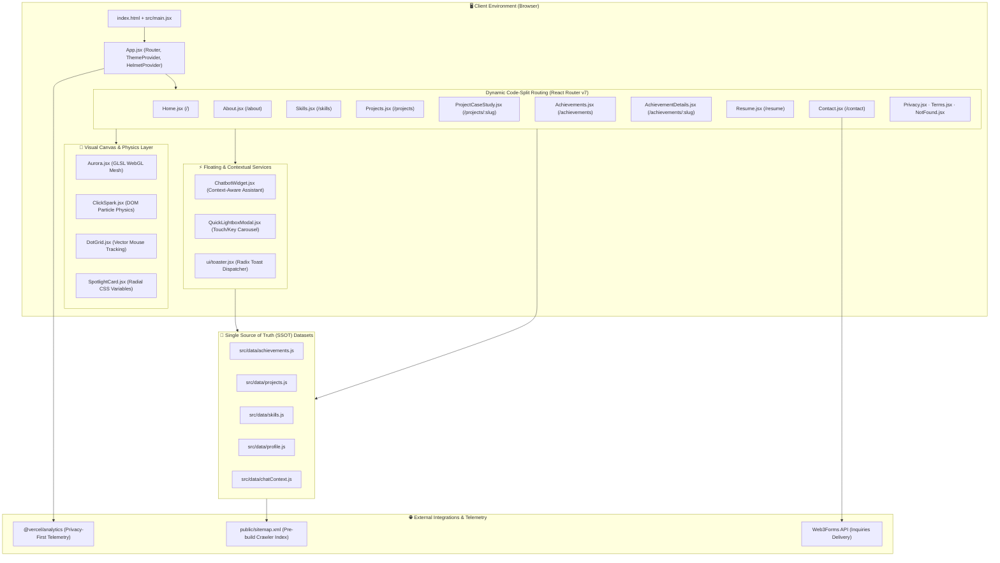
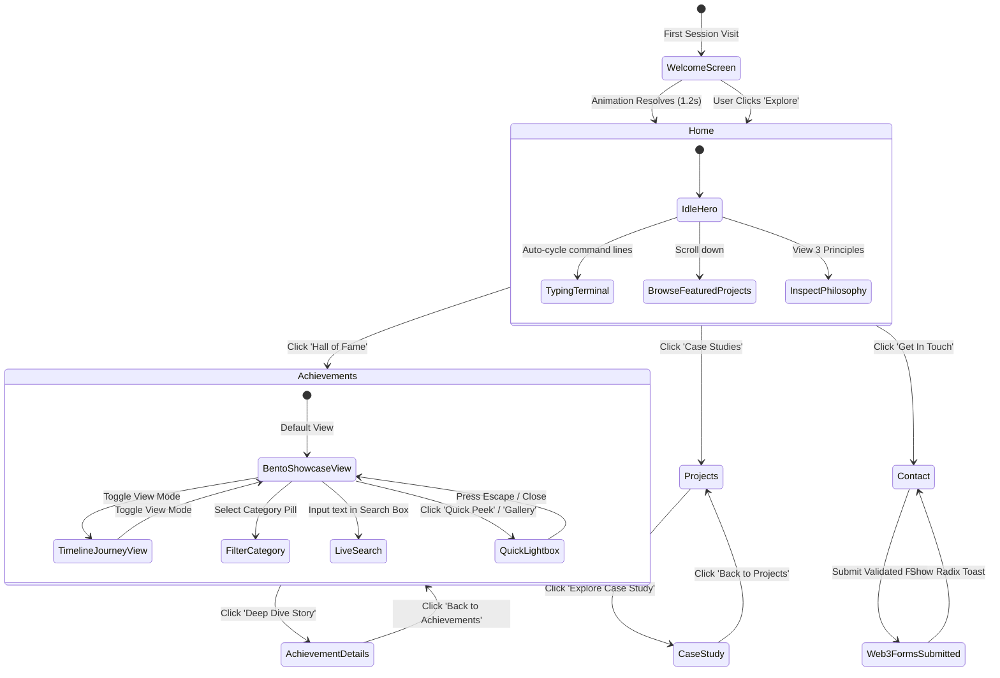
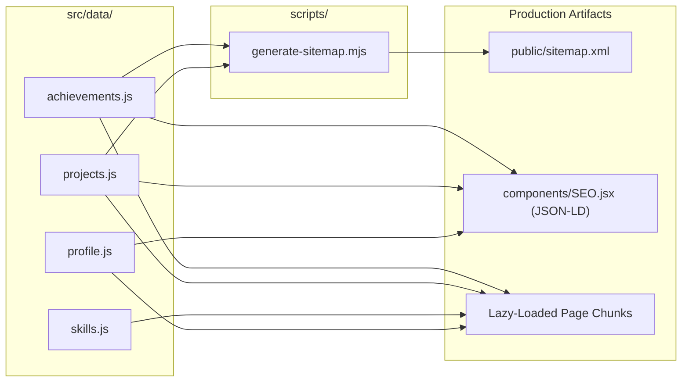
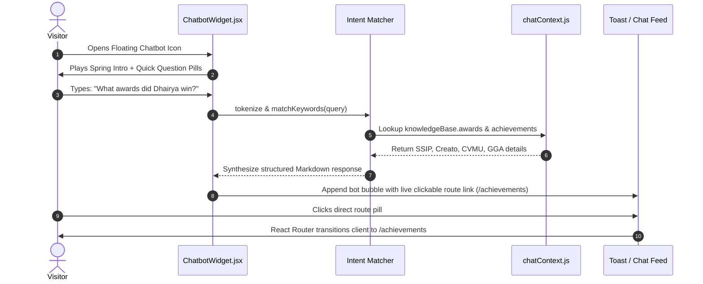

<div align="center">

# ⚡ SHAH DHAIRYA
### Full-Stack Developer · Digital Architect · Competitive Builder

<p align="center">
  <em>"I craft digital experiences at the intersection of engineering and design — where every pixel, interaction, and line of code serves a purpose."</em>
</p>

<!-- Hero OpenGraph Preview Banner -->
<p align="center">
  <a href="https://shahdhairyah.in" target="_blank">
    
  </a>
</p>

<!-- Live Action Buttons -->
<p align="center">
  <a href="https://shahdhairyah.in" target="_blank">
    
  </a>
  <a href="https://github.com/shahdhairyah" target="_blank">
    
  </a>
  <a href="https://www.linkedin.com/in/shahdhairyah/" target="_blank">
    
  </a>
  <a href="https://shahdhairyah.in/Dhairya-Shah-Resume.pdf" target="_blank">
    
  </a>
  <a href="mailto:sdhairyah@gmail.com">
    
  </a>
</p>

<!-- Architecture, Framework & CI/CD Status Shields -->
<p align="center">
  
  
  
  
  
  
  
  
  
</p>

</div>

---

## 📑 Table of Contents

1. [Executive Summary & The Vision](#1-executive-summary--the-vision)
   - [Design Philosophy: Void & Burnt Orange](#design-philosophy-void--burnt-orange)
   - [Core Tenets: Precision, Clarity, Performance](#core-tenets-precision-clarity-performance)
2. [Visual Showcase & Real-World Artifacts](#2-visual-showcase--real-world-artifacts)
   - [SSIP Hackathon — 4th Place (Sector)](#ssip-hackathon--4th-place-sector)
   - [ADIT CMS Enterprise Platform](#adit-cms-enterprise-platform)
   - [Creato 2024 State Innovation Award](#creato-2024-state-innovation-award)
   - [CVMU Hackathon 36-Hour Coding Sprint](#cvmu-hackathon-36-hour-coding-sprint)
   - [Smart Gujarat Government Water Logging Project](#smart-gujarat-government-water-logging-project)
3. [Verified Impact Numbers & Track Record](#3-verified-impact-numbers--track-record)
4. [System Architecture & Data Flows](#4-system-architecture--data-flows)
   - [Client-Side Single-Page Architecture](#client-side-single-page-architecture)
   - [User State & View Navigation Flow](#user-state--view-navigation-flow)
   - [Single Source of Truth (SSOT) Content Ingestion](#single-source-of-truth-ssot-content-ingestion)
   - [AI Assistant Intent Resolution Engine](#ai-assistant-intent-resolution-engine)
5. [Page-by-Page Technical Walkthrough](#5-page-by-page-technical-walkthrough)
   - [Home (`/`)](#home-)
   - [Achievements & Hall of Fame (`/achievements`)](#achievements--hall-of-fame-achievements)
   - [Individual Achievement Case Studies (`/achievements/:slug`)](#individual-achievement-case-studies-achievementsslug)
   - [Projects & Case Studies (`/projects`)](#projects--case-studies-projects)
   - [Project Deep Dives (`/projects/:slug`)](#project-deep-dives-projectsslug)
   - [The Craft & Skills Matrix (`/skills`)](#the-craft--skills-matrix-skills)
   - [About & Career Biography (`/about`)](#about--career-biography-about)
   - [Interactive Resume & PDF Engine (`/resume`)](#interactive-resume--pdf-engine-resume)
   - [Contact & Inquiry Channel (`/contact`)](#contact--inquiry-channel-contact)
   - [Legal & Utility Pages (`/privacy`, `/terms`, `/404`)](#legal--utility-pages-privacy-terms-404)
6. [Creative Canvas Shaders & ReactBits Physics Engine](#6-creative-canvas-shaders--reactbits-physics-engine)
   - [Dynamic Canvas Aurora Shaders](#dynamic-canvas-aurora-shaders)
   - [ClickSpark Particle Dispersion Engine](#clickspark-particle-dispersion-engine)
   - [DotGrid Vector Proximity Mesh](#dotgrid-vector-proximity-mesh)
   - [SpotlightCard Dynamic Radial Beams](#spotlightcard-dynamic-radial-beams)
   - [Cyberpunk DecryptedText Character Scrambler](#cyberpunk-decryptedtext-character-scrambler)
   - [Kinetic Typography & Star Borders](#kinetic-typography--star-borders)
7. [Design System & Token Architecture](#7-design-system--token-architecture)
   - [Tailwind CSS v4 Oxide Theme Configuration](#tailwind-css-v4-oxide-theme-configuration)
   - [Core Color Swatches & CSS Variables](#core-color-swatches--css-variables)
   - [Typography Hierarchy & Font Pairings](#typography-hierarchy--font-pairings)
   - [Custom Physics & Keyframe Motion Tokens](#custom-physics--keyframe-motion-tokens)
8. [Data Contracts & Content Schema Specifications](#8-data-contracts--content-schema-specifications)
   - [`src/data/achievements.js`](#srcdataachievementsjs)
   - [`src/data/projects.js`](#srcdataprojectsjs)
   - [`src/data/skills.js`](#srcdataskillsjs)
   - [`src/data/profile.js`](#srcdataprofilejs)
   - [`src/data/chatContext.js`](#srcdatachatcontextjs)
9. [SEO, Web Vitals & Security Architecture](#9-seo-web-vitals--security-architecture)
   - [Schema.org Structured Data (JSON-LD)](#schemaorg-structured-data-json-ld)
   - [Pre-Build Automated XML Sitemap Generator](#pre-build-automated-xml-sitemap-generator)
   - [Content Security Policy & HTTP Headers](#content-security-policy--http-headers)
   - [Route-Based Code Splitting Metrics](#route-based-code-splitting-metrics)
10. [Repository Directory & File Inventory](#10-repository-directory--file-inventory)
11. [Installation, Local Development & Production Build](#11-installation-local-development--production-build)
    - [Prerequisites](#prerequisites)
    - [Local Development Setup](#local-development-setup)
    - [Environment Variables](#environment-variables)
    - [Execution Scripts](#execution-scripts)
12. [Vercel Deployment & Production CI/CD](#12-vercel-deployment--production-cicd)
13. [Engineering Trade-Offs & FAQ](#13-engineering-trade-offs--faq)
14. [Author, Mentorship Tributes & License](#14-author-mentorship-tributes--license)

---

## 1. Executive Summary & The Vision

**shahdhairyah.in** is not a static portfolio template. It is an end-to-end, single-page progressive web application built from the ground up to present the engineering journey, full-stack case studies, and competitive hackathon record of **Shah Dhairya** (*Dhairya Shah*).

### Design Philosophy: Void & Burnt Orange

Most developer portfolios fall into one of two traps: sterile white-label minimalism or over-saturated neon distractions. This platform adopts an unapologetic **Deep Void (`#020202`) & Burnt Orange (`#bf4417` / `#ea580c` / `#ff9a4d`)** aesthetic inspired by high-end architectural monographs and high-performance developer terminal tooling.

- **Background Palette**: Absolute pitch black (`#020202`) with subtle dot matrices (`DotGrid`) and faint hairline grid overlays (`rgba(255,255,255,0.03)`).
- **Accent Radiance**: Burnt orange and amber gradients (`from-[#bf4417] via-amber-500 to-[#991b1b]`), evoking fire, energy, and competitive momentum under pressure.
- **Surface Elevation**: Layered semi-transparent glassmorphism (`bg-white/[0.03]`, `backdrop-blur-md`, `border-white/10`) with dynamic mouse-tracking specular highlights (`SpotlightCard`).
- **Typography**: Striking display headings set in **Syne** (bold, architectural, geometric), coupled with ultra-clean **Inter** for dense reading typography, and **JetBrains Mono** for terminal prompts, telemetry counters, and technical kickers.

### Core Tenets: Precision, Clarity, Performance

```
  ┌─────────────────────────────────────────────────────────────┐
  │                 THE TRIAD OF CRAFTSMANSHIP                  │
  ├──────────────────────────────┬──────────────────────────────┤
  │ 01. PRECISION                │ 02. CLARITY                  │
  │ Every margin, transition,    │ Complexity is hidden behind  │
  │ and bezier curve is measured.│ intuitive, effortless, and   │
  │ No layout thrashing.         │ scannable interfaces.        │
  ├──────────────────────────────┴──────────────────────────────┤
  │ 03. PERFORMANCE                                             │
  │ Speed is the baseline. 60 FPS transitions, route-level      │
  │ code splitting, and sub-second asset hydration.             │
  └─────────────────────────────────────────────────────────────┘
```

---

## 2. Visual Showcase & Real-World Artifacts

This repository archives genuine engineering milestones, state-level hackathon trophies, production deployments, and on-ground presentation photography.

<div align="center">

### 🏆 SSIP Hackathon — 4th Place (Sector)
*Competed against 2,062 teams (10,449 participants) across Gujarat. Shortlisted among 181 final teams; secured 4th place in sector.*

<a href="https://shahdhairyah.in/achievements/SSIP-2023">
  
</a>

<p><em>Dhairya Shah and team presenting the live automated hardware/software prototype to state-level evaluation juries.</em></p>

</div>

<br />

<div align="center">

| 💻 ADIT CMS Enterprise Platform | 🥇 Creato 2024 — Best Innovative Project |
| :---: | :---: |
| <a href="https://shahdhairyah.in/projects/adit-cms"></a> | <a href="https://shahdhairyah.in/achievements/bbit-creato-2024"></a> |
| **Enterprise Full-Stack CMS**: Role-based institutional platform replacing static department websites with dynamic React dashboards and PHP REST APIs. | **Best Innovative Project (Team CO17)**: State-level event organized by BBIT Anand. Honored for real-world problem solving and execution. |

| ⚡ CVMU Hackathon 2025 (Top 181) | 🏛️ Gujarat Gaurav Award 2026 |
| :---: | :---: |
| <a href="https://shahdhairyah.in/achievements/CVMU-2025"></a> | <a href="https://shahdhairyah.in/achievements/gujarat-gaurav-2026"></a> |
| **36+ Hour Live Coding Marathon**: Top 181 national teams selected. Live full-stack architecture demoed unscripted before industry judges. | **Smart Gujarat Government Recognition**: Honored for the urban Smart Water Logging mitigation system presented on 31 May 2026. |

</div>

---

## 3. Verified Impact Numbers & Track Record

Every number in the portfolio is backed by public records, certificates, and on-ground project deliverables:

```
┌────────────────────────────────────────────────────────────────────────────────────────┐
│                              COMPETITIVE ARENA METRICS                                 │
├───────────────────┬───────────────────┬───────────────────┬────────────────────────────┤
│       25+         │        2          │       17+         │          10,400+           │
│    HACKATHONS     │  STATE CHAMPION   │  FINALIST ROUNDS  │     COMPETITORS FACED      │
│     COMPETED      │      TITLES       │     QUALIFIED     │     ACROSS STATE POOLS     │
├───────────────────┴───────────────────┴───────────────────┴────────────────────────────┤
│ • SSIP Gujarat State Hackathon: 4th Place in Sector (2,062 teams / 10,449 participants) │
│ • Creato 2024: Best Innovative Project State Champion (Team CO17)                      │
│ • CVMU Hackathon 2025: Top 181 Teams Selection (36+ continuous build sprint)           │
│ • Gujarat Gaurav Award 2026: Smart Gujarat Govt Urban Water Logging Project            │
│ • Hackout 26: Top 5% National Placement (DAU & DAIICT National Arena)                  │
│ • Academic Baseline: Diploma in Computer Engineering at BBIT (7.90 CGPA)               │
│ • Undergraduate: B.Tech in Computer Engineering at ADIT (CVM University)               │
└────────────────────────────────────────────────────────────────────────────────────────┘
```

---

## 4. System Architecture & Data Flows

### Client-Side Single-Page Architecture



### User State & View Navigation Flow



### Single Source of Truth (SSOT) Content Ingestion



### AI Assistant Intent Resolution Engine



---

## 5. Page-by-Page Technical Walkthrough

### Home (`/`)
- **Hero Canvas**: Built with `@/components/reactbits/Aurora` utilizing dynamic GLSL color stops (`#bf4417`, `#ea580c`, `#7f1d1d`). Features kinetic character blurring via `BlurText` and glowing `ShinyText`.
- **Interactive Terminal Card**: Real-time rotating terminal simulating full-stack system introspection (`whoami`, `echo $STACK`, `open new_ideas`).
- **Interactive Floating Badges**: Code, Globe, Rocket, and Sparkles icons bouncing with custom physics calculations.
- **Tech Ticker Marquee**: Endless, hardware-accelerated marquee cycling across core technologies.
- **Featured Case Study Spotlight**: Large preview cards with live status badges (`Live`, `In Production`), role indicators, stack pills, and direct case study links.
- **Philosophy Triad**: Three architectural cards highlighting *Precision*, *Clarity*, and *Performance*.

### Achievements & Hall of Fame (`/achievements`)
- **Competitive Track Record Bento**: Four interactive `SpotlightCard` tiles displaying dynamic count-up animations for:
  - `25+` Hackathon Participant
  - `2` State Championship Titles
  - `17+` Finalist Rounds Selected
  - `10,400+` Participants Faced (outcompeted across 2,062+ teams)
- **Crowning Milestone Spotlight**: High-impact horizontal split hero card highlighting the **SSIP State Hackathon 2023** with real on-ground prototype demonstration photography, 3-column impact metrics, and key takeaways.
- **Dual View Modes**:
  - **Showcase Bento Grid**: Rich cards featuring on-ground cover photos, glowing rank crests, 3-column stat pills, bulleted takeaways, role badges, and quick links.
  - **Chronological Timeline**: Vertical visual journey from 2023 to 2026 connected by a glowing gradient spine.
- **Quick-Peek Photo Lightbox**: Modal carousel allowing visitors to preview on-ground event photos, presentations, and award certificates directly on the page without navigating away.
- **Filter Pills & Real-Time Search**: Instant filtering across *Winners & Awards*, *State & National*, and *36h Sprints* with spring physics pill animations.
- **Hackathon Playbook (Philosophy)**: Three cards explaining the technical approach:
  1. `01 / High-Velocity Architecture`: Schema & core APIs locked within 4 hours.
  2. `02 / Real Production, Zero Mocks`: Fully working code with live databases and sensor telemetry.
  3. `03 / High-Stakes Pitching`: Clear business impact and unscripted demos under state jury scrutiny.
- **Jury & Mentor Recognition Panel**: Dedicated tribute featuring the **CVMU 2025 Hackathon Jury** quote alongside gratitude for **BBIT Anand** mentors and state organizers.

### Individual Achievement Case Studies (`/achievements/:slug`)
- Dynamic parameter extraction via `useParams()`.
- Deep narrative story explaining the problem statement, team composition, constraints, and judging outcome.
- High-resolution interactive gallery with mobile touch-swipe support (`onTouchStart`, `onTouchEnd`) and keyboard arrow controls.
- Verifiable metrics matrix and mentor acknowledgments.

### Projects & Case Studies (`/projects`)
- Filterable case study catalog categorized into *Web Applications*, *IoT & AI*, and *Digital Products*.
- Framer Motion `layoutId="project-filter-pill"` spring transitions for zero-jank pill switching.
- Detailed metadata badges: status indicator pulse, category tag, role tag, and completion year.

### Project Deep Dives (`/projects/:slug`)
- Comprehensive technical documentation per project:
  - **The Problem Statement**: Real-world friction that necessitated the solution.
  - **The Architectural Solution**: Technical approach, schema choices, and framework rationale.
  - **Technical Highlights Checklist**: Bulleted engineering capabilities.
  - **Metrics Matrix**: Measurable performance indicators (e.g. latency, role segregation, storage efficiency).
  - **Live Action Links**: Direct triggers for live production demos and open-source GitHub code repositories.

### The Craft & Skills Matrix (`/skills`)
- Multi-dimensional classification system:
  - Category filters: *Frontend*, *Backend*, *Databases*, *Cloud & DevOps*.
  - Tier classification: *Core* (daily drivers), *Proficient* (production-tested), *Familiar* (architectural understanding).
- SVG vector logos dynamically served from Devicon CDN with fallback heuristics.
- Interactive cross-linking: Clicking any skill immediately reveals the projects built with that technology.

### About & Career Biography (`/about`)
- In-depth biographical narrative detailing Dhairya's transition from curiosity-driven coding in 2021 to high-stakes hackathons, competitive full-stack development, and architectural engineering.
- Academic trajectory: BBIT Computer Engineering Diploma (7.90 CGPA) through B.Tech at ADIT (CVM University).
- Personal coding principles and design values.

### Interactive Resume & PDF Engine (`/resume`)
- Clean, structured online CV formatted for rapid recruiter scanning.
- Direct download button streaming [`/Dhairya-Shah-Resume.pdf`](file:///home/shahdhairyah/DHAIRYA/React-Project/shahdhairyah.in/public/Dhairya-Shah-Resume.pdf).
- Dedicated sections for Experience, Education, Hackathon Championships, and Technical Skills.

### Contact & Inquiry Channel (`/contact`)
- Functional, accessible contact form with name, email, subject, and message fields.
- Integration with Web3Forms API via `VITE_WEB3FORMS_KEY`.
- Built-in fallback: If the API key is not present or an error occurs, the form smoothly falls back to an encoded `mailto:` link, ensuring messages are never lost.
- Interactive Radix UI toast notifications validating successful submission.

### Legal & Utility Pages (`/privacy`, `/terms`, `/404`)
- Accessible privacy policy and terms of service documenting data handling, cookies, and telemetry disclosures.
- Custom styled 404 Not Found error page with quick links back to the home route.

---

## 6. Creative Canvas Shaders & ReactBits Physics Engine

The portfolio contains a specialized suite of interactive visual components located in `src/components/reactbits/`.

### Dynamic Canvas Aurora Shaders
File: [`src/components/reactbits/Aurora.jsx`](file:///home/shahdhairyah/DHAIRYA/React-Project/shahdhairyah.in/src/components/reactbits/Aurora.jsx)

Renders an organic, smoothly undulating aurora borealis effect inside an HTML5 `<canvas>` element using simulated fluid turbulence algorithms.
- **Configurable Props**: `colorStops` (array of hex colors), `speed`, `amplitude`, `opacity`.
- **Performance**: Runs on `requestAnimationFrame` with automatic canvas resizing and pixel density matching.

```javascript
<Aurora
  colorStops={["#bf4417", "#ea580c", "#7f1d1d"]}
  speed={0.45}
  amplitude={1.0}
  opacity={0.5}
/>
```

### ClickSpark Particle Dispersion Engine
File: [`src/components/reactbits/ClickSpark.jsx`](file:///home/shahdhairyah/DHAIRYA/React-Project/shahdhairyah.in/src/components/reactbits/ClickSpark.jsx)

Wraps root page views and spawns a burst of lightweight SVG particle rays whenever the user clicks anywhere on the viewport.
- **Configurable Props**: `color` (`#ff9a4d`), `count` (10 particles), `size` (14px), `radius` (34px).
- **Physics**: Exponential decay curve on particle opacity and velocity for an energetic spark effect.

### DotGrid Vector Proximity Mesh
File: [`src/components/reactbits/DotGrid.jsx`](file:///home/shahdhairyah/DHAIRYA/React-Project/shahdhairyah.in/src/components/reactbits/DotGrid.jsx)

Renders a grid of coordinate dots across the canvas. When the visitor's cursor traverses the screen, dots within a specified radial threshold calculate their Euclidean distance from the cursor and subtly scale and illuminate in burnt orange.

### SpotlightCard Dynamic Radial Beams
File: [`src/components/reactbits/SpotlightCard.jsx`](file:///home/shahdhairyah/DHAIRYA/React-Project/shahdhairyah.in/src/components/reactbits/SpotlightCard.jsx)

Calculates the mouse's relative `(X, Y)` position within card boundaries using `getBoundingClientRect()` and dynamically updates CSS custom properties `--spotlight-x` and `--spotlight-y`. An absolute positioned pseudo-element renders a radial gradient spotlight that follows the cursor seamlessly.

### Cyberpunk DecryptedText Character Scrambler
File: [`src/components/reactbits/DecryptedText.jsx`](file:///home/shahdhairyah/DHAIRYA/React-Project/shahdhairyah.in/src/components/reactbits/DecryptedText.jsx)

Simulates futuristic decryption sequences. When entering the viewport, target strings randomize their glyphs with alphanumeric noise characters before settling one-by-one into their final readable characters.

### Kinetic Typography & Star Borders
- **`BlurText.jsx`**: Animates individual words or characters from a blurred, translated state into sharp focus.
- **`ShinyText.jsx`**: CSS-animated background clipping that sweeps a bright metallic glare across text.
- **`GradientText.jsx`**: Continuous color-shifting gradient text with optional radial glow filters.
- **`StarBorder.jsx`**: Creates an animated glowing border that circles continuously around interactive buttons.
- **`CountUp.jsx`**: Smooth numerical tweening for stats using easing curves.
- **`Magnet.jsx`**: Physical magnetic pull effect that gently pulls interactive elements toward the cursor.

---

## 7. Design System & Token Architecture

### Tailwind CSS v4 Oxide Theme Configuration
File: [`src/index.css`](file:///home/shahdhairyah/DHAIRYA/React-Project/shahdhairyah.in/src/index.css)

The application utilizes **Tailwind CSS v4** featuring the new CSS-first `@theme` engine.

```css
@import url("https://fonts.googleapis.com/css2?family=Syne:wght@400..800&family=Inter:wght@400;500;600;700&family=JetBrains+Mono:wght@400;500&display=swap");
@import "tailwindcss";

@theme {
  /* Surface & Base Palette */
  --color-bg: #020202;
  --color-surface: #0a0a0a;
  --color-surface-2: #141414;
  --color-ink: #f5f5f5;
  --color-ink-muted: #8b8b8b;
  --color-ink-faint: #404040;

  /* Brand Accents (Burnt Orange & Gold) */
  --color-gold: #bf4417;
  --color-gold-bright: #ea580c;
  --color-hairline: rgba(255, 255, 255, 0.08);
  --color-hairline-soft: rgba(255, 255, 255, 0.04);
  --color-void: #000000;

  /* Typography Families */
  --font-display: "Syne", ui-sans-serif, system-ui, sans-serif;
  --font-sans: "Inter", ui-sans-serif, system-ui, sans-serif;
  --font-mono: "JetBrains Mono", ui-monospace, "SF Mono", monospace;

  /* Border Radii */
  --radius-sm: 0.375rem;
  --radius-md: 0.5rem;
  --radius-lg: 0.75rem;
  --radius-xl: 1rem;
  --radius-2xl: 1.25rem;

  /* Keyframe Animations */
  --animate-fade-up: fade-up 0.9s cubic-bezier(0.16, 1, 0.3, 1) forwards;
  --animate-pulse-slow: pulse-slow 3s ease-in-out infinite;
  --animate-marquee-left: marquee-left 22s linear infinite;
  --animate-float: float-y 5s ease-in-out infinite;
  --animate-blink: blink 1.1s steps(2, start) infinite;
}
```

### Core Color Swatches & CSS Variables

| Token Name | Hex / Value | Semantic Role |
| :--- | :--- | :--- |
| `--bg` | `#020202` | Deep void canvas background |
| `--surface` | `#0a0a0a` | Elevated card & modal background |
| `--surface-2` | `#141414` | Secondary pill & input field fill |
| `--gold` | `#bf4417` | Primary brand burnt orange accent |
| `--gold-bright`| `#ea580c` | High-intensity hover & glowing state |
| `--ink` | `#f5f5f5` | Primary headline & reading text |
| `--ink-muted` | `#8b8b8b` | Subtitles, body copy, and secondary labels |
| `--hairline` | `rgba(255,255,255,0.08)`| Subtle structural borders |

### Custom Physics & Keyframe Motion Tokens

All Framer Motion physics use the standardized cubic bezier curve:
```javascript
export const EASE = [0.16, 1, 0.3, 1];
```
This quintic ease-out curve provides a responsive initial snap followed by a smooth, tactile deceleration.

---

## 8. Data Contracts & Content Schema Specifications

All portfolio data is decoupled from presentation components and maintained in `src/data/`.

### `src/data/achievements.js`
Exports `hackathons` array and `achievementCategories`:

```typescript
interface HackathonStat {
  value: string;
  label: string;
}

interface TeamMember {
  name: string;
  role: string;
}

interface HackathonRecord {
  slug: string;             // Unique URL slug (/achievements/:slug)
  icon: LucideIcon;         // Trophy | Award | Medal
  rank: string;             // "4th", "CO17", "181", "2026", "Top 5%"
  category: string;         // "Winners & Awards" | "State & National" | "36h Sprints"
  badge: string;            // Card header badge text
  featured: boolean;        // High-priority hero spotlight toggle
  title: string;            // Full display title
  org: string;              // Organizing body & level
  year: string;             // Display year
  period?: string;          // Optional multi-year timeline
  date?: string;            // Exact event date
  image: string;            // Primary cover image path
  gallery: string[];        // Array of high-res event image paths
  captions?: string[];      // Array of captions matching gallery images
  text: string;             // Concise executive summary
  story?: string;           // Extended first-person deep dive narrative
  stats: HackathonStat[];   // 3 key impact metrics
  details: string[];        // Array of bulleted takeaways
  team?: TeamMember[];      // Optional team roster
  role?: string;            // Dhairya's specific engineering role
}
```

<<<<<<< HEAD
=======
#### Concrete Data Record Example (`SSIP-2023`)

```javascript
{
  slug: "SSIP-2023",
  icon: Trophy,
  rank: "4th",
  category: "State & National",
  badge: "State Finalist · 4th Place",
  featured: true,
  title: "SSIP Hackathon — 4th Place My Sector",
  org: "SSIP Gujarat · State Level",
  year: "2023",
  period: "2023-2024",
  image: "/images/achievement/ssip-2023-cover.webp",
  text: "Competed against 2062 teams (10449 participants) across Gujarat. Our team was among 181 selected for the final round and secured 4th place in my sector.",
  story: "2062 teams. 10,449 participants. One weekend that redefined how far we could push ourselves. What started as a rough idea scribbled on a whiteboard turned into a live, working product presented to state-level judges — and all of it happened inside a single high-pressure hackathon. Walking away with 4th place in my sector, we didn't just earn a rank; we proved that ideas only truly come alive the moment a team decides to commit, code, and ship.",
  stats: [
    { value: "2062", label: "Teams (10449 participants)" },
    { value: "181", label: "Teams selected" },
    { value: "4th", label: "Place in my sector" },
  ],
  details: [
    "2062 teams · 10449 participants registered across Gujarat",
    "181 teams shortlisted for the final round",
    "Built and demoed a live working product to state-level judges",
    "Secured 4th place in my sector",
    "Learned to ship a product under real deadline pressure",
    "An unforgettable lesson in teamwork, stamina and problem-solving",
  ],
  captions: [
    "Live prototype demo to state judges — presenting our working solution mechanism",
    "The arena is set — teams across Gujarat gather for the weekend",
    "Whiteboard first: turning a rough idea into a plan of attack",
    "The demo table — when the product has to speak for itself",
    "Deep in the build, every line of code pulling us closer to the deadline",
    "On stage, live — presenting our solution to the state-level judges",
    "That walk away from the stage after securing 4th place in our sector",
  ],
  gallery: [
    "/images/achievement/ssip-2023-cover.webp",
    "/images/achievement/ssip-2023-01.webp",
    "/images/achievement/ssip-2023-02.webp",
    "/images/achievement/ssip-2023-03.webp",
    "/images/achievement/ssip-2023-04.webp",
    "/images/achievement/ssip-2023-05.webp",
    "/images/achievement/ssip-2023-06.webp",
  ],
  role: "Core Developer & Pitch Presenter",
}
```

>>>>>>> 900dd4c (updated archivments)
### `src/data/projects.js`
Exports `projects` array and `projectCategories`:

```typescript
interface ProjectRecord {
  id: number;
  slug: string;             // URL slug (/projects/:slug)
  title: string;            // Project title
  category: string;         // "Web Application" | "IoT & AI"
  year: string;
  role: string;             // e.g. "Full-Stack Developer"
  status: string;           // "Live", "In Production", "Complete"
  image: string;            // High-res preview image
  coverPosition?: string;   // CSS object-position override
  tagline: string;          // Concise one-sentence summary
  stack: string[];          // Array of technologies used
  githubUrl?: string;       // Public code repository link
  demoUrl?: string;         // Deployed live application link
  featured: boolean;        // Featured on home route toggle
  stats: { value: string; label: string }[];
  problemTitle: string;     // Problem section heading
  problem: string;          // Problem description narrative
  solutionTitle: string;    // Architectural solution heading
  solutionIntro: string;    // Overview of solution
  solutionPoints: string[]; // Bullet points explaining technical build
  capabilities: string[];   // Capability tags
}
```

<<<<<<< HEAD
=======
#### Concrete Data Record Example (`adit-cms`)

```javascript
{
  id: 4,
  slug: "adit-cms",
  title: "ADIT CMS Platform",
  category: "Web Application",
  year: "2026",
  role: "Full-Stack Developer",
  status: "Live",
  image: "/images/projects/ADITCMS/cover.png",
  coverPosition: "center 01%",
  tagline: "A full-stack content management system built for ADIT — a role-aware platform for managing departments, events, notices, gallery, and placements, replacing static pages with a dynamic, admin-controlled experience.",
  stack: ["React", "PHP", "MySQL", "Bootstrap", "REST API"],
  githubUrl: "https://github.com/shahdhairyah/ADITCMS",
  demoUrl: "https://adit.shahdhairyah.in/",
  featured: true,
  stats: [
    { value: "Full-stack", label: "Architecture" },
    { value: "Role-based", label: "Access Control" },
    { value: "Dynamic", label: "Content Mgmt" },
    { value: "Live", label: "In Production" },
  ],
  problemTitle: "Static Website, Zero Admin Control",
  problem: "The institution's website was static HTML — every update needed a developer. Departments had no way to publish events, notices, or gallery updates on their own, and content stayed outdated for weeks.",
  solutionTitle: "Dynamic CMS with Role-Based Admin Panel",
  solutionIntro: "Built a React-powered front end with a PHP REST API backend and MySQL database, giving admins and department heads a clean dashboard to manage every section of the site in real time.",
  solutionPoints: [
    "React front end with Bootstrap for a responsive, fast interface",
    "PHP REST API backend with MySQL for reliable data management",
    "Role-based access — admins and department heads see different dashboards",
    "Dynamic content sections: events, notices, gallery, placements",
    "Real-time content updates without touching code",
  ],
  capabilities: [
    "Role-Based Access",
    "Content Management",
    "REST API Backend",
    "Responsive Dashboard",
    "Multi-Department Administration",
  ],
}
```

>>>>>>> 900dd4c (updated archivments)
### `src/data/skills.js`
Exports `skills` array, `skillCategories`, and `skillTiers`:
- Classified by `tier`: `"core"`, `"proficient"`, `"familiar"`.
- Classified by `category`: `"frontend"`, `"backend"`, `"database"`, `"tools"`.
- Cross-references projects that use each skill.

### `src/data/profile.js`
Stores identity attributes:
- `name`: `"Shah Dhairya"` (`"Dhairya Shah"`)
- `role`: `"Digital Architect"`
- `title`: `"Full-Stack Developer & Digital Architect"`
- `location`: `"Gujarat, India · Anand"`
- `education`: `"Computer Engineering, ADIT (CVM University), Anand"`
- `email`: `"sdhairyah@gmail.com"`
- `phone`: `"+91 70692 76736"`
- `website`: `"https://shahdhairyah.in"`
- `socials`: Array of links for GitHub, LinkedIn, Instagram, and LeetCode.
- `philosophy`: Triad of principles (*Precision*, *Clarity*, *Performance*).
- `timeline`: Career milestones from 2021 to 2026.

### `src/data/chatContext.js`
Powers the floating AI inquiries assistant with structured knowledge regarding Dhairya's skillset, education, hackathons, and availability.

---

## 9. SEO, Web Vitals & Security Architecture

### Schema.org Structured Data (JSON-LD)
File: [`src/components/SEO.jsx`](file:///home/shahdhairyah/DHAIRYA/React-Project/shahdhairyah.in/src/components/SEO.jsx)

Every route injects structured Schema.org JSON-LD scripts to provide search engine crawlers with machine-readable context:

```json
{
  "@context": "https://schema.org",
  "@type": "Person",
  "name": "Shah Dhairya",
  "alternateName": "Dhairya Shah",
  "url": "https://shahdhairyah.in/",
  "image": "https://shahdhairyah.in/og-image.png",
  "jobTitle": "Full-Stack Developer & Digital Architect",
  "sameAs": [
    "https://github.com/shahdhairyah",
    "https://www.linkedin.com/in/shahdhairyah/",
    "https://www.instagram.com/shahdhairyah",
    "https://leetcode.com/shahdhairyah"
  ],
  "knowsAbout": [
    "React", "PHP", "JavaScript", "Python", "Node.js", "MySQL", "Tailwind CSS", "REST APIs", "IoT Systems"
  ]
}
```

### Pre-Build Automated XML Sitemap Generator
File: [`scripts/generate-sitemap.mjs`](file:///home/shahdhairyah/DHAIRYA/React-Project/shahdhairyah.in/scripts/generate-sitemap.mjs)

A pre-build Node.js script parses `src/data/projects.js` and `src/data/achievements.js` via regex to extract all dynamic slugs. It generates a valid `public/sitemap.xml` with priorities and change frequencies before Vite compiles the production bundle.

### Content Security Policy & HTTP Headers
File: [`vercel.json`](file:///home/shahdhairyah/DHAIRYA/React-Project/shahdhairyah.in/vercel.json)

Production edge routing includes hardened security headers:
- **`Content-Security-Policy`**: Enforces strict script, style, and connect boundaries (restricting forms and APIs exclusively to `self`, `api.web3forms.com`, and `va.vercel-scripts.com`).
- **`X-Frame-Options`**: `DENY` (prevents clickjacking attacks).
- **`X-Content-Type-Options`**: `nosniff`.
- **`Strict-Transport-Security`**: `max-age=63072000; includeSubDomains; preload`.
- **`Referrer-Policy`**: `strict-origin-when-cross-origin`.
- **Immutable Asset Caching**: 1-year cache headers (`public, max-age=31536000, immutable`) for all hashed chunks under `/assets/`.

### Route-Based Code Splitting Metrics

```
dist/index.html                               2.32 kB │ gzip:   0.74 kB
dist/assets/index-D5Y6BgXs.css              114.25 kB │ gzip:  16.69 kB
dist/assets/index-C-XrlGx8.js               432.81 kB │ gzip: 140.36 kB
dist/assets/Achievements-Ox70tbUj.js         34.81 kB │ gzip:   8.80 kB
dist/assets/Home-u2m-lpxU.js                 42.08 kB │ gzip:  14.78 kB
dist/assets/About-Pg8foa6R.js                32.47 kB │ gzip:  11.71 kB
dist/assets/Contact-DR8_OQLL.js              28.92 kB │ gzip:   8.16 kB
dist/assets/Skills-DBJAN1Am.js               15.58 kB │ gzip:   5.35 kB
dist/assets/ProjectCaseStudy-DvfY4zwO.js     14.18 kB │ gzip:   4.33 kB
dist/assets/AchievementDetails-P2NGBFXJ.js   12.62 kB │ gzip:   3.98 kB
dist/assets/Resume-DJ1AOogl.js               12.90 kB │ gzip:   4.20 kB
```

---

## 10. Repository Directory & File Inventory

```bash
shahdhairyah.in/
├── public/                       # Static public web assets
│   ├── images/
│   │   ├── achievement/          # Real hackathon photos & covers
│   │   │   ├── ssip-2023-cover.jpg # SSIP 4th Place prototype demonstration
│   │   │   ├── ssip-2023-cover.webp
│   │   │   ├── creo-2024-cover.webp # Creato 2024 award ceremony
│   │   │   ├── cvmu-2025-cover.webp # CVMU 2025 sprint finals
│   │   │   └── gga-2026-cover.webp  # Gujarat Gaurav Award cover
│   │   ├── projects/             # Case study covers & UI screenshots
│   │   └── testimonials/         # Professional endorsement avatars
│   ├── Dhairya-Shah-Resume.pdf   # Printable official resume
│   ├── logo.png / logo.svg       # Brand identity logomarks
│   ├── og-image.png              # 1200x630 OpenGraph social banner
│   ├── robots.txt                # Search crawler instructions
│   └── sitemap.xml               # Dynamically generated search sitemap
├── scripts/
│   └── generate-sitemap.mjs      # Automated pre-build XML sitemap generator
├── src/
│   ├── assets/                   # Profile pictures & developer icons
│   ├── components/               # Modular component hierarchy
│   │   ├── home/                 # Hero terminal, cards, and ease physics
│   │   │   ├── cards.jsx         # TerminalCard, FeaturedProjectCard, PhilosophyCard
│   │   │   ├── ease.js           # Standard cubic bezier easing token
│   │   │   └── effects.jsx       # Floating social and brand icon SVGs
│   │   ├── reactbits/            # Canvas shaders and interactive physics
│   │   │   ├── Aurora.jsx        # WebGL canvas fluid aurora
│   │   │   ├── ClickSpark.jsx    # Particle ray click dispersion
│   │   │   ├── DotGrid.jsx       # Mouse proximity coordinate mesh
│   │   │   ├── SpotlightCard.jsx # Mouse-tracking radial beam card
│   │   │   ├── DecryptedText.jsx # Cyberpunk text scrambler
│   │   │   ├── BlurText.jsx      # Kinetic blur-in text
│   │   │   ├── ShinyText.jsx     # Metallic text shimmer sweep
│   │   │   ├── GradientText.jsx  # Continuous color-shifting gradient
│   │   │   ├── Magnet.jsx        # Magnetic attraction interaction
│   │   │   ├── StarBorder.jsx    # Luminous orbital border track
│   │   │   └── CountUp.jsx       # Eased numerical counter
│   │   ├── shared/               # Reusable headers, tickers, and CTAs
│   │   │   ├── PageCTA.jsx       # Universal conversion footer banner
│   │   │   └── Ticker.jsx        # Infinite looping tech marquee
│   │   ├── ui/                   # Radix UI primitive implementations
│   │   │   ├── toast.jsx         # Accessible viewport toast component
│   │   │   └── toaster.jsx       # Toast provider container
│   │   ├── ChatbotWidget.jsx     # Floating context-aware portfolio AI assistant
│   │   ├── CursorAccent.jsx      # Subtle desktop cursor glow accent
│   │   ├── ErrorBoundary.jsx     # Graceful React runtime error boundary
│   │   ├── Footer.jsx            # Global footer with social handles
│   │   ├── JourneyTimeline.jsx   # Vertical milestone progression timeline
│   │   ├── Navbar.jsx            # Glassmorphic responsive navigation
│   │   ├── PageHeader.jsx        # Aurora-backed page titles with kickers
│   │   ├── PageLayout.jsx        # Shared page structure container
│   │   ├── SEO.jsx               # Dynamic meta tag & JSON-LD injector
│   │   └── WelcomeScreen.jsx     # Initial session splash sequence
│   ├── data/                     # Single source of truth data records
│   │   ├── achievements.js       # Hackathons, award categories, and galleries
│   │   ├── chatContext.js        # AI chatbot knowledge base
│   │   ├── profile.js            # Bio, contact, stats, and timeline
│   │   ├── projects.js           # Case studies, problem/solutions, stack
│   │   └── skills.js             # Categorized skill tiers and mappings
│   ├── hooks/
│   │   └── use-toast.js          # Radix toast dispatching hook
│   ├── lib/
│   │   └── utils.js              # Class merging utilities (`clsx` + `twMerge`)
│   ├── pages/                    # Code-split page route views
│   │   ├── About.jsx             # Comprehensive personal story & credentials
│   │   ├── AchievementDetails.jsx# Individual hackathon deep-dive case studies
│   │   ├── Achievements.jsx      # Redesigned Hall of Fame & competitive records
│   │   ├── Contact.jsx           # Form submission with Web3Forms & mail fallback
│   │   ├── Home.jsx              # Landing page & executive summary
│   │   ├── NotFound.jsx          # Custom styled 404 handler
│   │   ├── Privacy.jsx           # Privacy policy disclosures
│   │   ├── ProjectCaseStudy.jsx  # Individual project breakdown page
│   │   ├── Projects.jsx          # Filterable project case studies catalog
│   │   ├── Resume.jsx            # Interactive CV & resume viewer
│   │   ├── Skills.jsx            # The Craft — skill tiers & project tags
│   │   └── Terms.jsx             # Terms of service disclosures
│   ├── App.jsx                   # Lazy page routing & transition orchestrator
│   ├── main.jsx                  # React 18 DOM mount point
│   └── index.css                 # Tailwind CSS v4 directives & custom themes
├── .env.example                  # Environment variable template
├── .eslintrc.cjs                 # ESLint ruleset (zero-warning policy)
├── package.json                  # Dependencies and execution scripts
├── vercel.json                   # Edge routing, rewrites, and security headers
└── vite.config.js                # Vite build and path aliases configuration (`@/*`)
```

---

## 11. Installation, Local Development & Production Build

### Prerequisites

- **Node.js**: `v18.0.0` or higher
- **npm**: `v9.0.0` or higher (or `pnpm` / `yarn`)
- **Git**

### Local Development Setup

1. **Clone the repository**:
   ```bash
   git clone https://github.com/shahdhairyah/react-tailwind-portfolio.git
   cd react-tailwind-portfolio
   ```

2. **Install project dependencies**:
   ```bash
   npm install
   ```

3. **Configure environment variables**:
   ```bash
   cp .env.example .env
   ```

4. **Start the local development server**:
   ```bash
   npm run dev
   ```
   Open **`http://localhost:5173`** in your browser to view the application with Hot Module Replacement (HMR).

### Environment Variables

File: `.env`

```env
# Contact form email delivery access key from https://web3forms.com
# (If unset, the contact form automatically falls back to opening the visitor's mail client)
VITE_WEB3FORMS_KEY=your_web3forms_key_here
```

### Execution Scripts

| Script Command | Lifecycle & Functionality |
| :--- | :--- |
| `npm run dev` | Boots up the local Vite development server at `http://localhost:5173`. |
| `npm run build` | Executes `prebuild` (`generate-sitemap.mjs`) and compiles the production bundle in `dist/`. |
| `npm run preview` | Serves the production build locally to audit bundle performance and routing. |
| `npm run lint` | Runs ESLint across all `.js` and `.jsx` files, enforcing a zero-warning threshold. |
| `npm run sitemap` | Standalone manual execution of the dynamic XML sitemap generation script. |

---

## 12. Vercel Deployment & Production CI/CD

The portfolio is deployed continuously on the **Vercel Edge Network**.

### Deploying Your Own Copy

1. **Push your code to GitHub**:
   ```bash
   git add .
   git commit -m "feat: deploy portfolio"
   git push origin main
   ```

2. **Import into Vercel**:
   - Go to [vercel.com](https://vercel.com) and click **"Add New Project"**.
   - Select your GitHub repository.
   - Framework Preset: **Vite**.
   - Build Command: `npm run build` (automatically runs sitemap prebuild).
   - Output Directory: `dist`.

3. **Configure Environment Variables in Vercel**:
   - Add `VITE_WEB3FORMS_KEY` under **Project Settings > Environment Variables**.

4. **Trigger Deployment**:
   - Vercel automatically deploys every push to `main` with automatic preview deployments on pull requests.

---

## 13. Engineering Trade-Offs & FAQ

### Why Vite + React 18 instead of Next.js?
For a developer portfolio and project showcase, a Client-Side Rendered (CSR) Single-Page Application (SPA) powered by Vite offers instantaneous client-side navigation without cold-start serverless function latency. Combined with pre-built XML sitemaps and dynamic Schema.org JSON-LD headers, search engines index every page cleanly while users enjoy smooth Framer Motion page transitions.

### Why Tailwind CSS v4?
Tailwind CSS v4 introduces the high-performance Rust-based Oxide engine. It removes the legacy `tailwind.config.js` in favor of a clean, CSS-first `@theme` syntax that compiles instantly and eliminates CSS bloat.

### How is 60 FPS maintained across low-end mobile devices?
- GPU-accelerated transforms (`translate3d`, `scale`) are preferred over layout-triggering properties (`top`, `width`, `height`).
- Canvas shaders (Aurora, DotGrid) adjust their sampling and resolution automatically to avoid taxing mobile GPUs.
- Heavy route views are code-split and loaded on demand.

---

## 14. Author, Mentorship Tributes & License

### Author

**Shah Dhairya (Dhairya Shah)**  
*Full-Stack Developer & Digital Architect*  
Anand, Gujarat, India

<p>
  <a href="https://shahdhairyah.in" target="_blank">
    
  </a>
  <a href="https://github.com/shahdhairyah" target="_blank">
    
  </a>
  <a href="https://www.linkedin.com/in/shahdhairyah/" target="_blank">
    
  </a>
  <a href="https://www.instagram.com/shahdhairyah" target="_blank">
    
  </a>
  <a href="https://leetcode.com/shahdhairyah" target="_blank">
    
  </a>
  <a href="mailto:sdhairyah@gmail.com">
    
  </a>
</p>

### Mentorship & Institutional Acknowledgments

- **BBIT Anand**: Heartfelt gratitude to mentors **Darshan Desai Sir**, **Rakesh Verma Sir**, **Hardik Sir**, and the faculty team for foundational guidance, direction, and technical mentorship.
- **ADIT (CVM University)**: Acknowledgment to faculty and peers supporting ongoing B.Tech research and full-stack system architecture.
- **Hackathon Evaluation Panels**: Respect and gratitude to the state-level evaluation juries of the **SSIP Gujarat Hackathon**, **CVMU Hackathon 2025**, and organizers **Ankit Bhatmani** & **Mital Shah** for the Gujarat Gaurav recognition.

---

### License

This repository is distributed under the **MIT License**.

```
MIT License

Copyright (c) 2026 Shah Dhairya

Permission is hereby granted, free of charge, to any person obtaining a copy
of this software and associated documentation files (the "Software"), to deal
in the Software without restriction, including without limitation the rights
to use, copy, modify, merge, publish, distribute, sublicense, and/or sell
copies of the Software, and to permit persons to whom the Software is
furnished to do so, subject to the following conditions:

The above copyright notice and this permission notice shall be included in all
copies or substantial portions of the Software.

THE SOFTWARE IS PROVIDED "AS IS", WITHOUT WARRANTY OF ANY KIND, EXPRESS OR
IMPLIED, INCLUDING BUT NOT LIMITED TO THE WARRANTIES OF MERCHANTABILITY,
FITNESS FOR A PARTICULAR PURPOSE AND NONINFRINGEMENT. IN NO EVENT SHALL THE
AUTHORS OR COPYRIGHT HOLDERS BE LIABLE FOR ANY CLAIM, DAMAGES OR OTHER
LIABILITY, WHETHER IN AN ACTION OF CONTRACT, TORT OR OTHERWISE, ARISING FROM,
OUT OF OR IN CONNECTION WITH THE SOFTWARE OR THE USE OR OTHER DEALINGS IN THE
SOFTWARE.
```

<div align="center">
  <sub>Architected & Engineered with precision by <strong>Shah Dhairya</strong> · Hosted on the Vercel Edge Network.</sub>
</div>
