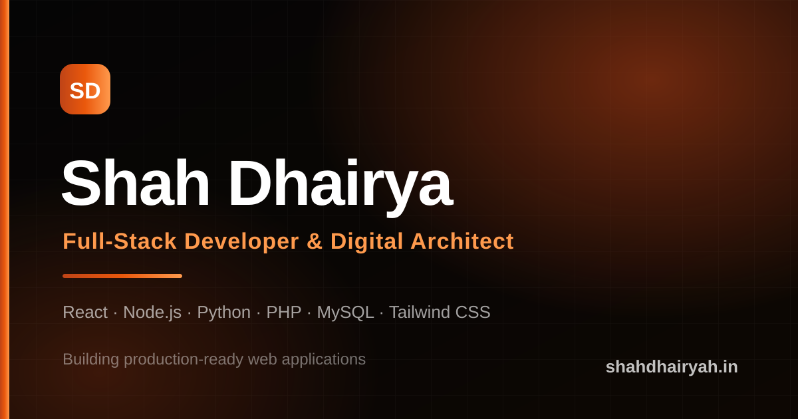
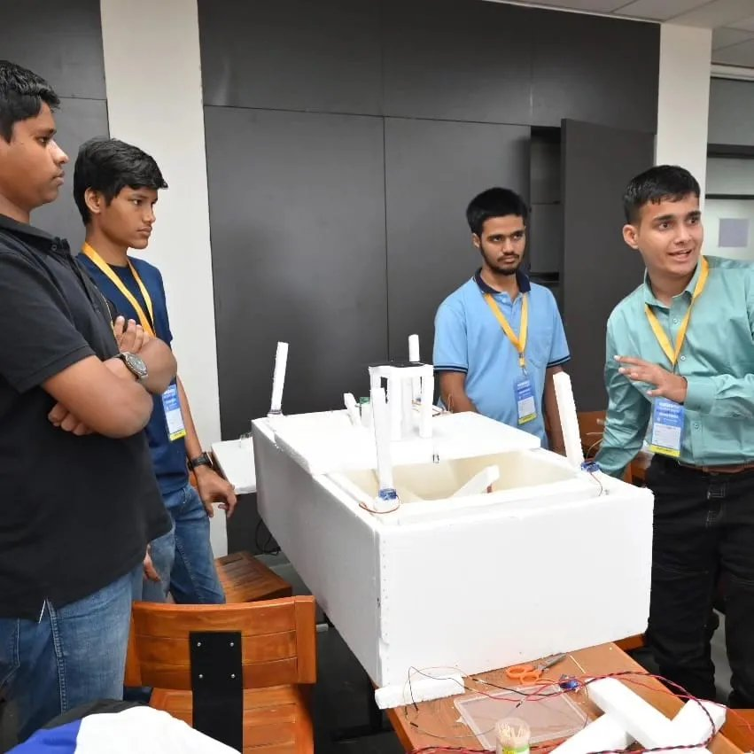
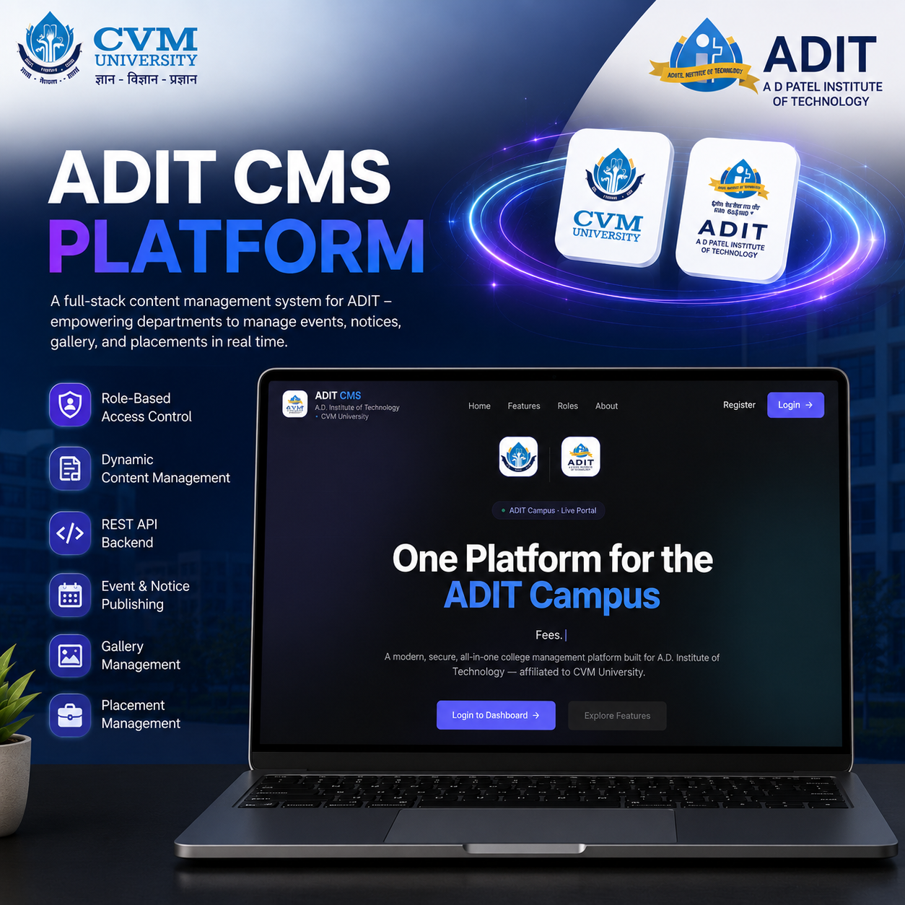
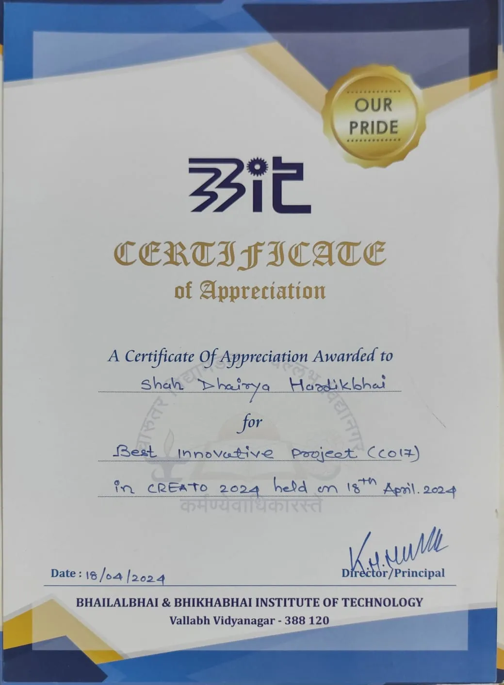
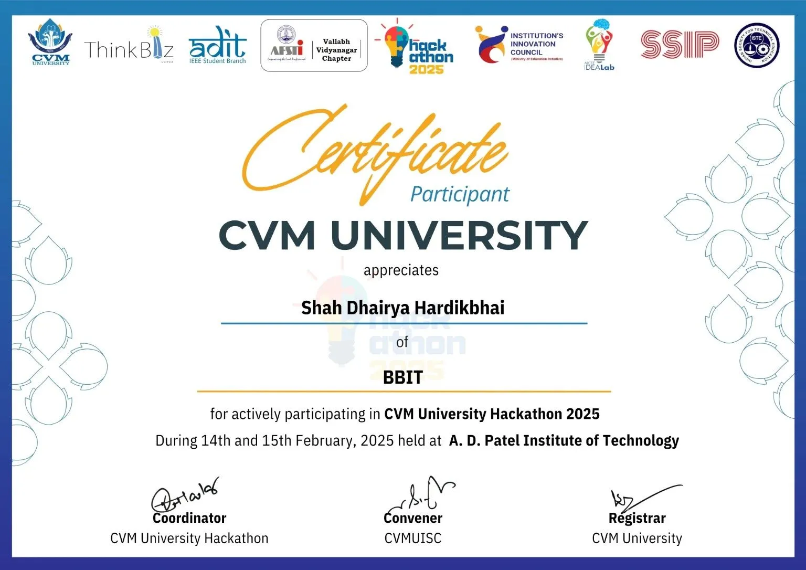
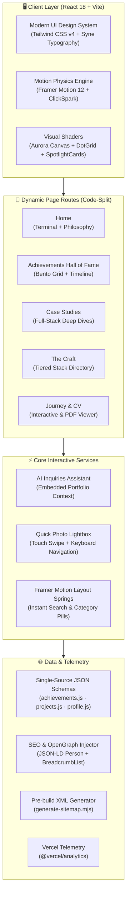

<div align="center">

# ⚡ SHAH DHAIRYA
### Full-Stack Developer & Digital Architect

<p align="center">
  <em>"I craft digital experiences at the intersection of engineering and design — where every pixel, interaction, and line of code serves a purpose."</em>
</p>

<!-- Hero Banner Preview -->
<p align="center">
  <a href="https://shahdhairyah.in" target="_blank">
    
  </a>
</p>

<!-- Quick Action Badges -->
<p align="center">
  <a href="https://shahdhairyah.in" target="_blank">
    
  </a>
  <a href="https://github.com/shahdhairyah" target="_blank">
    
  </a>
  <a href="https://www.linkedin.com/in/shahdhairyah/" target="_blank">
    
  </a>
  <a href="mailto:sdhairyah@gmail.com">
    
  </a>
</p>

<!-- Technology & Build Status Shields -->
<p align="center">
  
  
  
  
  
  
  
  
</p>

</div>

---

## 📸 Visual Showcase & Featured Moments

<div align="center">

| 🏆 SSIP Hackathon — 4th Place (Sector) | 💻 ADIT CMS Platform (Case Study) |
| :---: | :---: |
| <a href="https://shahdhairyah.in/achievements/SSIP-2023"></a> | <a href="https://shahdhairyah.in/projects/adit-cms"></a> |
| **Outcompeted 2,062 teams (10,449 participants)** across Gujarat with a working hardware/software solution demoed live to state judges. | **Production Full-Stack CMS** built with React, PHP REST API, and MySQL for institutional role-based administration. |

| 🥇 Creato 2024 — Best Innovative Project | ⚡ CVMU Hackathon — Top 181 Finalist |
| :---: | :---: |
| <a href="https://shahdhairyah.in/achievements/bbit-creato-2024"></a> | <a href="https://shahdhairyah.in/achievements/CVMU-2025"></a> |
| **Best Innovative Project Winner (Team CO17)** at BBIT Anand State-Level engineering convention. | **36+ Hour Live Coding Sprint** — selected among top 181 national teams for unscripted live jury evaluation. |

</div>

---

## 📊 Executive Track Record & Impact

<div align="center">

| Metric | Achievement Record | Context & Scope |
| :---: | :--- | :--- |
| 🚀 | **25+ Hackathons Competed** | 3+ years of intense 36h+ live continuous building and unscripted demos |
| 🏆 | **2 State Championship Honors** | Gujarat Gaurav Award (Govt Water Logging) & BBIT Creato Best Innovative Project |
| 🎯 | **17+ Finalist Selections** | Shortlisted into final rounds across state and national competitive pools |
| 👥 | **10,400+ Competitors Faced** | 2,062+ registered teams in state arenas like SSIP Gujarat & CVMU Hackathon |
| 🎓 | **7.90 CGPA Diploma in CE** | BBIT Anand graduate, currently pursuing B.Tech in Computer Engineering at ADIT (CVMU) |

</div>

---

## 🏛️ System Architecture



---

## 🌟 Key Features

### 1. 🏆 Redesigned Achievements Hall of Fame
- **Bento Grid Showcase**: Visual cards with on-ground event cover photos, glowing rank crests, 3-stat metric pills, role indicators, and key takeaway bullet points.
- **Chronological Timeline Journey**: Interactive vertical milestone roadmap spanning 2023 to 2026 connected by a luminous gradient spine (`from-[#bf4417] via-amber-500 to-[#991b1b]`).
- **Inline Photo Lightbox**: Instant modal carousel allowing visitors to browse on-ground event photos, presentations, and award certificates without leaving the page.
- **Dynamic Category & Search Filters**: Instant filtering across *Winners & Awards*, *State & National*, and *36h Sprints* with spring physics pill animations.

### 2. ⚡ Terminal Card & Creative Shaders
- **Interactive Terminal**: Auto-typing shell simulating real-time system introspection (`whoami`, `echo $STACK`, `open new_ideas`).
- **Creative Canvas Shaders**: Custom WebGL/Canvas Aurora background, interactive ClickSpark particles, and reactive DotGrid meshes.
- **Glassmorphism Spotlight Cards**: Radial mouse-following spotlights for interactive depth.

### 3. 💼 Full-Stack Case Studies
- In-depth problem statement vs. architectural solution breakdowns:
  - **ADIT CMS Platform**: Role-based institutional content management system with React frontend and PHP/MySQL REST API.
  - **Smart IoT Monitoring Platform**: Hardware telemetry integration for environmental intelligence.
  - **Real-Time Weather Engine**: Responsive meteorological dashboard.
- Features technical stack chips, architectural decisions, live demo triggers, and GitHub repository links.

### 4. 🛠️ The Craft — Technical Competencies Matrix
- Categorized across **Frontend**, **Backend**, **Databases**, and **Cloud & Tools**.
- Classified by proficiency tier (`Core`, `Proficient`, `Familiar`) with direct cross-references to projects utilizing each tool.

### 5. 🤖 Embedded AI Assistant
- Context-aware chatbot widget embedded with Dhairya's engineering profile, project stack, and hackathon milestones to provide instant answers to recruiter inquiries.

### 6. 🌐 Modern SEO & Telemetry
- Schema.org JSON-LD structured data (`Person`, `BreadcrumbList`).
- Automated pre-build XML sitemap generation via Node.js script.
- Clean social graph previews (Twitter Cards, OpenGraph 1200x630 banner).

---

## 💻 Tech Stack

<div align="center">

| Layer | Technologies |
| :--- | :--- |
| **Core Framework** | `React 18.3` · `Vite 5.3` · `JavaScript (ESNext)` |
| **Styling & Design** | `Tailwind CSS 4.1` · `CSS Custom Properties` · `Glassmorphism` |
| **Motion & Physics** | `Framer Motion 12.17` · `Canvas Aurora` · `Spring Physics` |
| **UI Components** | `Lucide React` · `React Icons` · `Radix UI Primitives` · `Next Themes` |
| **Backend & APIs** | `PHP 8` · `MySQL` · `Node.js` · `REST APIs` · `Web3Forms` |
| **SEO & Telemetry** | `React Helmet Async` · `Schema.org JSON-LD` · `@vercel/analytics` |
| **Deployment & Hosting**| `Vercel Edge Network` · `Git & GitHub CI/CD` |

</div>

---

## 📁 Repository Structure

```bash
shahdhairyah.in/
├── public/                       # Static public assets
│   ├── images/
│   │   ├── achievement/          # Hackathon event photography & cover photos
│   │   ├── projects/             # Case study covers & UI screenshots
│   │   └── testimonials/         # Endorsement avatars
│   ├── Dhairya-Shah-Resume.pdf   # Printable PDF resume
│   ├── og-image.png              # 1200x630 Social card preview
│   └── sitemap.xml               # Dynamically generated search index
├── scripts/
│   └── generate-sitemap.mjs      # Pre-build automated sitemap script
├── src/
│   ├── components/               # Modular component architecture
│   │   ├── home/                 # Hero terminal, project previews, philosophy
│   │   ├── reactbits/            # Creative shaders (Aurora, ClickSpark, DotGrid, SpotlightCard)
│   │   ├── shared/               # Reusable CTAs, tickers, and navigation headers
│   │   ├── ui/                   # Radix UI accessible toasts
│   │   ├── ChatbotWidget.jsx     # AI portfolio inquiries widget
│   │   ├── Navbar.jsx            # Glassmorphic top navigation bar
│   │   ├── PageHeader.jsx        # Aurora-backed page headers
│   │   ├── SEO.jsx               # Dynamic meta tag & JSON-LD manager
│   │   └── Footer.jsx            # Social handles & legal disclaimer
│   ├── data/                     # Single-source-of-truth datasets
│   │   ├── achievements.js       # Hackathons, award categories, and gallery entries
│   │   ├── chatContext.js        # AI chatbot knowledge base
│   │   ├── profile.js            # Bio, social links, stats, and milestones
│   │   ├── projects.js           # Full-stack case studies and specs
│   │   └── skills.js             # Categorized technical competencies
│   ├── pages/                    # Code-split page routes
│   │   ├── Home.jsx              # Executive landing experience
│   │   ├── About.jsx             # Biography, timeline, and philosophy
│   │   ├── Achievements.jsx      # Redesigned Hall of Fame & competitive records
│   │   ├── AchievementDetails.jsx# Deep-dive hackathon case study pages
│   │   ├── Projects.jsx          # Filterable project case studies catalog
│   │   ├── ProjectCaseStudy.jsx  # Individual project breakdown
│   │   ├── Skills.jsx            # The Craft — skill tiers & project tags
│   │   ├── Resume.jsx            # Interactive CV & resume viewer
│   │   ├── Contact.jsx           # Form submission & direct channels
│   │   └── NotFound.jsx          # Custom 404 handler
│   ├── App.jsx                   # Lazy page routing & transition orchestrator
│   ├── main.jsx                  # Application entry point
│   └── index.css                 # Tailwind CSS v4 directives & custom themes
├── vercel.json                   # Route rewrites & security headers
└── vite.config.js                # Vite bundler configuration & `@/*` path aliases
```

---

## 🚀 Quick Start & Local Setup

### Prerequisites
- **Node.js**: `v18.0.0` or higher
- **npm** (or `pnpm` / `yarn`)

### 1. Clone the repository
```bash
git clone https://github.com/shahdhairyah/react-tailwind-portfolio.git
cd react-tailwind-portfolio
```

### 2. Install dependencies
```bash
npm install
```

### 3. Setup environment variables (Optional)
```bash
cp .env.example .env
```
*(Optionally provide `VITE_WEB3FORMS_KEY` for contact form emails; otherwise, it defaults to native email clients).*

### 4. Start the local development server
```bash
npm run dev
```
Open **`http://localhost:5173`** in your browser.

---

## 🛠️ Build & Verification Scripts

```bash
# Start Vite development server with HMR
npm run dev

# Run strict ESLint verification (0 errors, 0 warnings enforced)
npm run lint

# Pre-generate sitemap.xml and compile optimized production build
npm run build

# Preview production build locally
npm run preview

# Generate updated XML sitemap manually
npm run sitemap
```

---

## ⚡ Performance & Engineering Standards

- **Lazy Dynamic Code Splitting**: All major views load dynamically via `React.lazy` and `Suspense`, keeping the main bundle around **~140 kB gzipped**.
- **Modern WebP Compression**: Gallery and project imagery optimized for rapid transfer without sacrificing visual fidelity.
- **Strict Linting Hygiene**: Enforced zero-warning policy across all React components and hooks.
- **Fluid Viewport Adaptability**: Pixel-perfect scaling across mobile smartphones, tablets, laptops, and ultra-wide desktop monitors.

---

## 📬 Contact & Connect

<div align="center">

**Shah Dhairya**  
*Full-Stack Developer & Digital Architect*  
Anand, Gujarat, India

[](https://shahdhairyah.in)
[](https://github.com/shahdhairyah)
[](https://www.linkedin.com/in/shahdhairyah/)
[](https://www.instagram.com/shahdhairyah)
[](mailto:sdhairyah@gmail.com)

</div>

---

<div align="center">
  <sub>Designed & Developed with precision by <strong>Shah Dhairya</strong>. Released under the <a href="LICENSE">MIT License</a>.</sub>
</div>
